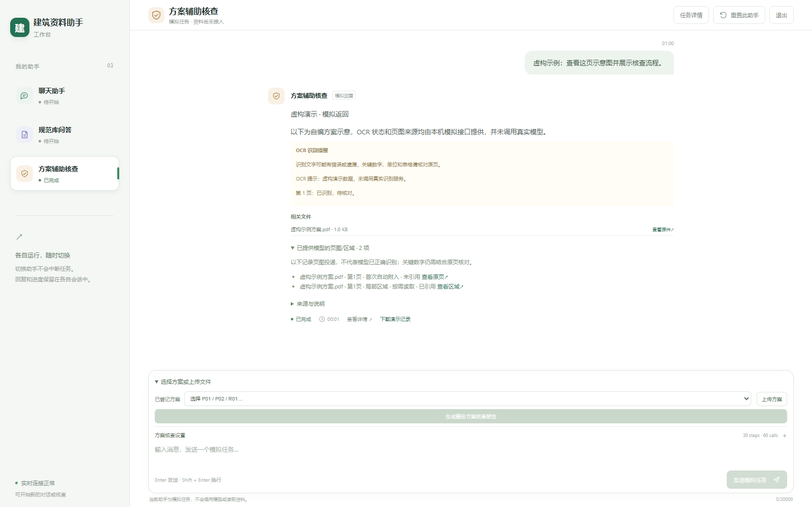

# RAG Arch Demo

[English](README.md) | [简体中文](README_CN.md)

RAG Arch Demo is a building-document assistant that answers questions with cited source evidence and checks submitted plans to produce findings reports. This repository is a selected snapshot of an evolving project, showing its main engineering implementation rather than a complete delivery. Users provide their own materials and service configuration and complete the environment integrations they need.

## Core workflow and architecture

- Process supplied PDF and DOCX files and retain source locations; Linux also supports legacy DOC conversion.
- Retrieve evidence with BM25 and dense search, fuse candidates with RRF, and apply reranking.
- Answer with citations, check quotations in plans, and generate evidence-linked reports.
- Inspect whole pages or regions for visual review; optionally supplement candidate pages with cloud OCR.

The default web workbench uses React, FastAPI, PostgreSQL, and independent AI workers. It includes account-scoped tasks, resumable task events, and shared read-only retrieval packages. See the [architecture guide](docs/architecture.md).

## Workbench preview



Captured on 2026-10-29 using self-authored fictional inputs and a simulated local API. This illustrates the interface; it does not validate live OCR or model results. See the [documentation index](docs/README.md) for the page viewer and historical screenshots.

## Web workbench

A web deployment needs PostgreSQL, model credentials, and a corpus supplied by the operator. Cloud OCR is optional and disabled by default. See the [setup guide](docs/setup.md) for installation and startup steps.

## Offline sample

Python 3.12 or newer is required. The authored CLI uses deterministic stand-ins and fictional inputs; it does not review arbitrary plans.

```powershell
python -m venv .venv
.\.venv\Scripts\Activate.ps1
python -m pip install -e .
python -m demo --output output
```

On Linux or macOS, activate with `source .venv/bin/activate`. Markdown and JSON results are written to `output/`.

## More documentation

See the [documentation index](docs/README.md) ([中文](docs/zh-CN/README.md)) for architecture, setup, evaluation, publication scope, screenshots, and validation records. See [Contributing](.github/CONTRIBUTING.md) before proposing a change.

## License

Project-owned code is licensed under [MIT](LICENSE). Third-party components retain their own terms; see [third-party notices](docs/third_party_notices.md).
