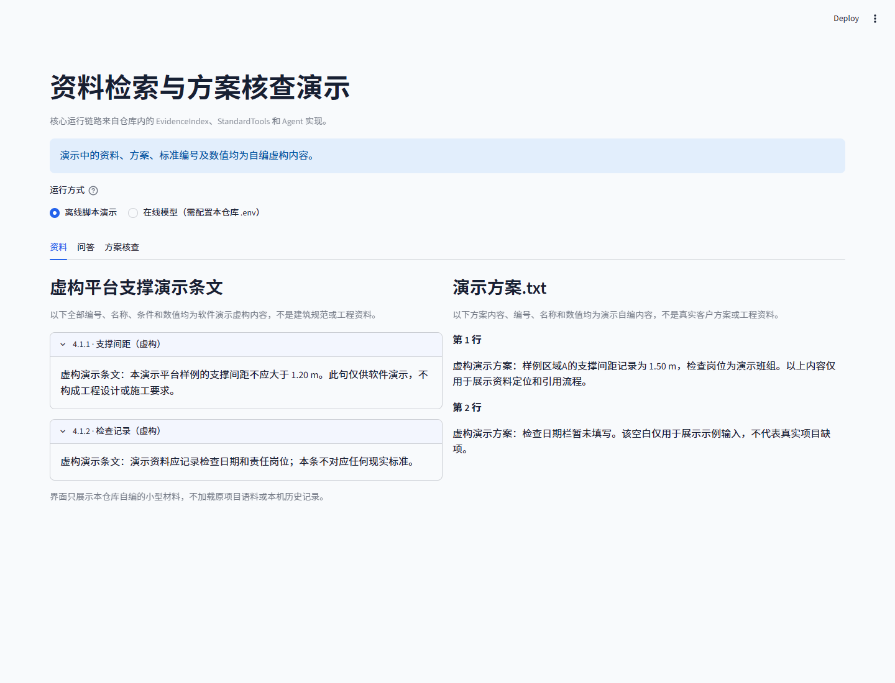
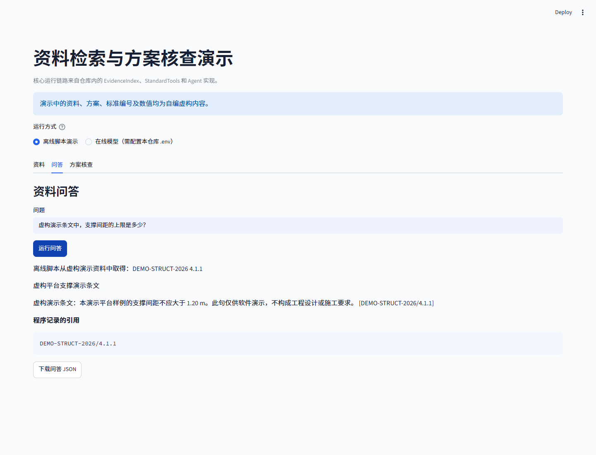
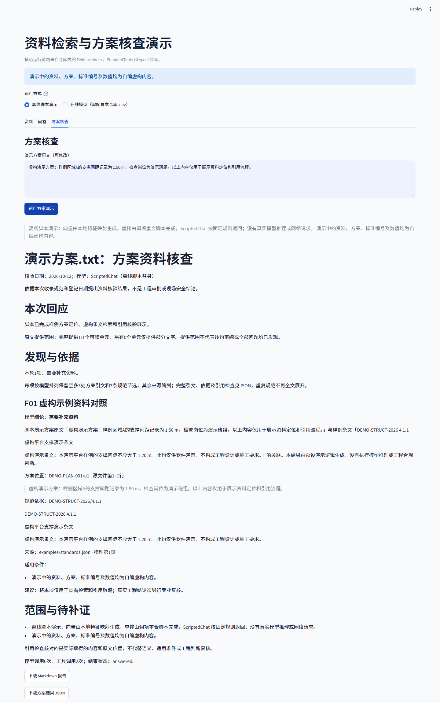

# RAG Arch Demo | Traceable Document Q&A and Plan Review

[English](README.md) | [简体中文](README_CN.md)

Follow the path from source documents to cited evidence in the report: ingest documents and plans, run BM25 and vector retrieval, fuse results with RRF, rerank candidates, retrieve evidence through tools, verify quotations from the plan, and produce a sourced report.

This is a standalone public demo of a building-document assistant, prepared for code review, interview discussions, and small-scale local use. The core workflow comes from a real project. This repository was initialized independently, without importing the original Git history. The full standards library, real project plans, and runtime logs are excluded.

## Run the demo

Requirements: Python 3.12, Windows/macOS/Linux, and a browser. The default offline mode needs no API keys or model downloads and makes no requests to external model services.

```bash
python -m venv .venv
# Windows PowerShell:
.\.venv\Scripts\Activate.ps1
# macOS/Linux: source .venv/bin/activate
python -m pip install -r requirements.txt
python -m pip install --no-deps -e .
python -m demo --output output
python -m streamlit run app.py --server.address 127.0.0.1
```

The command-line demo writes `output/report.md`, `output/standard_answer.json`, and `output/plan_review.json`. The web app supports document browsing, document Q&A, plan review, and report downloads. The included [sample report](examples/sample_report.md) is offline output generated from fictional demo inputs.

```bash
python -m demo --mode offline --standards examples/standards.json --plan examples/demo_plan.json --output output
python -m unittest discover -s tests -v
python scripts/verify_public_tree.py
```

Offline vector search, reranking, and chat use deterministic scripted substitutes; the actual retriever, evidence tools, and Agent graph loop are retained. The substitutes show how data and calls move through the workflow. They cover only the topics designed into the examples and cannot review arbitrary engineering plans. All `DEMO` documents and values are fictional and written for this project; they are not engineering standards.

## Run with online services

Copy `.env.example` to `.env`, then replace the placeholders with your own service URLs, model names, and API keys. The chat model must support tool calling. The embedding service must be compatible with the original OpenAIEmbeddings adapter. Cloud reranking uses the retained Bailian adapter. Model choices and parameter limits depend on the services you use.

```bash
python -m demo --mode live --output output
```

Online mode requires network access and permission to use the selected services, and may incur charges. It uses the same fictional demo documents and does not read configuration from the original project. Online settings that have not been tested with actual model calls should not be treated as a deployed service. The web app's online mode must also be selected explicitly.

## Core implementation and contribution

I led the implementation of the building-document assistant and am authorized to publish the code selected for this demo. This repository focuses on the document loading and source-location workflow, hybrid retrieval and reranking, evidence tools, tool loop, long-plan context handling, citation verification, and report delivery. The retriever and client designs that draw on course material retain their original comments and source acknowledgements.

The [architecture and reading guide](docs/architecture_en.md) maps each stage to the source code. A useful review path is:

1. `loaders.py` / `splitting.py`: How is text extracted, how are locations preserved, and how are gaps from scanned pages surfaced?
2. `retrieval.py` / `evidence_index.py`: How are Chinese text and numbers tokenized, how do BM25, cosine similarity, and RRF scores differ, and how do candidates reach reranking?
3. `standard_tools.py` / `graph_agent.py`: What evidence does the model receive, and how are citation IDs limited to evidence retrieved in the current run?
4. `plan_review_agent.py` / `plan_review_evidence.py`: How are full-plan, batched, and final evidence connected, and how are quotations from the plan verified?
5. `plan_review_report.py` / `model_input_view.py`: How are sources delivered, and how is repeated metadata reduced while preserving the text and traceability?

`demo/` contains the examples and runtime adapters; `rag_arch/` retains the application code. File origins are listed in the [source manifest](docs/core_manifest.json). Course-derived comments are retained. Project-authored code is provided under the [MIT License](LICENSE). Third-party dependencies retain their own licenses; see [third-party notices](THIRD_PARTY_NOTICES.md). This demo does not add multi-user support, a permissions system, or a large framework.

## Screenshots

These initial-release screenshots use fictional demo documents and offline runs. They contain no real source documents or customer information. The current app loads the full sample plan; see the [regression fixes](docs/review_fixes_20261012_en.md).





## Existing results and limitations

In a historical 60-question retrieval regression, adding reranking to the same RRF candidate pool raised Recall@8 from 0.8444 to 0.8722 and increased complete evidence matches from 44/60 to 47/60. At Top-4, complete evidence matches fell from 40/60 to 39/60. On a fixed 240-question AECBench QA set, accuracy on decodable answer choices rose from 146/240 to 184/240.

The five-plan whole-plan evaluation used 59 fixed development reference items. These results measure reference coverage, not full-report accuracy; they do not establish that RAG consistently improves technical findings across whole plans. The [evaluation notes](docs/evaluation_en.md) describe the scope, native-review comparison, unfavorable results, and changes that cannot be attributed to RAG. This public demo does not include the original evaluation inputs or claim that its small examples reproduce those results.

Citation checks can verify sources and quoted text. They cannot automatically establish engineering applicability, correctness of conclusions, or completeness of issue discovery. Text extraction gaps, charts, and complex calculations still require manual review.

## Repository layout

```text
app.py                  Streamlit demo app
rag_arch/               Retained application implementation
demo/                   Offline/online runtime adapters
examples/               Fictional demo documents, plan, and sample report
docs/                   Architecture, evaluation, publication scope, screenshots
scripts/                Public-file checks
tests/                  Limited offline workflow checks
.env.example            Placeholders only
requirements.txt        Verified direct dependency versions
```

[Initial release validation](docs/validation_en.md) records installation, offline tests, and UI checks. [Publication scope and review](docs/publication_en.md) describes the cleanup boundaries. `.env`, outputs, logs, vector caches, attachments, and archives are ignored by default; newly added materials still need review.

## License

MIT covers project-authored code only. Third-party components retain their own licenses. This project provides no assurance about third-party use or compliance, and does not guarantee that dependencies, combined applications, or generated outputs are cleared for commercial use. Users must check the applicable terms for their intended use, distribution, and deployment. See [copyright and third-party notices](THIRD_PARTY_NOTICES.md).
