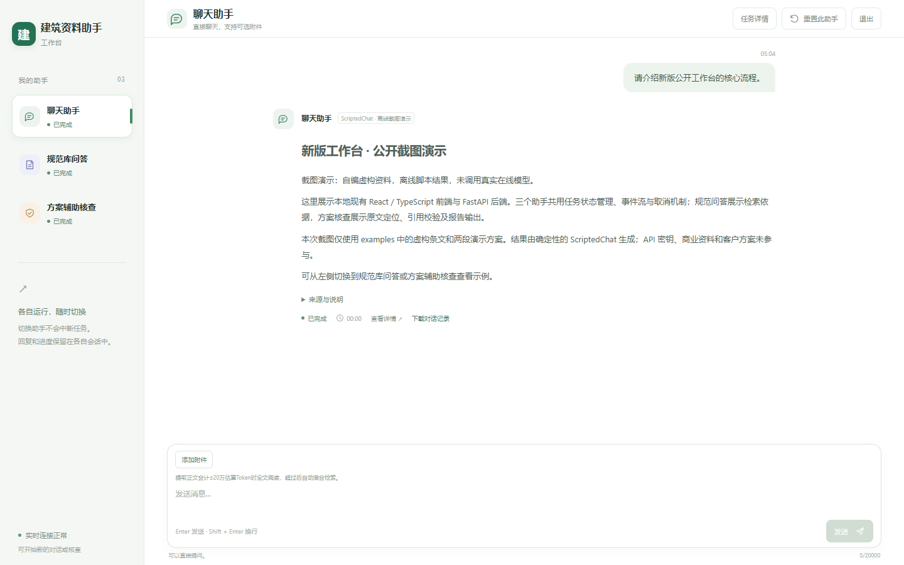
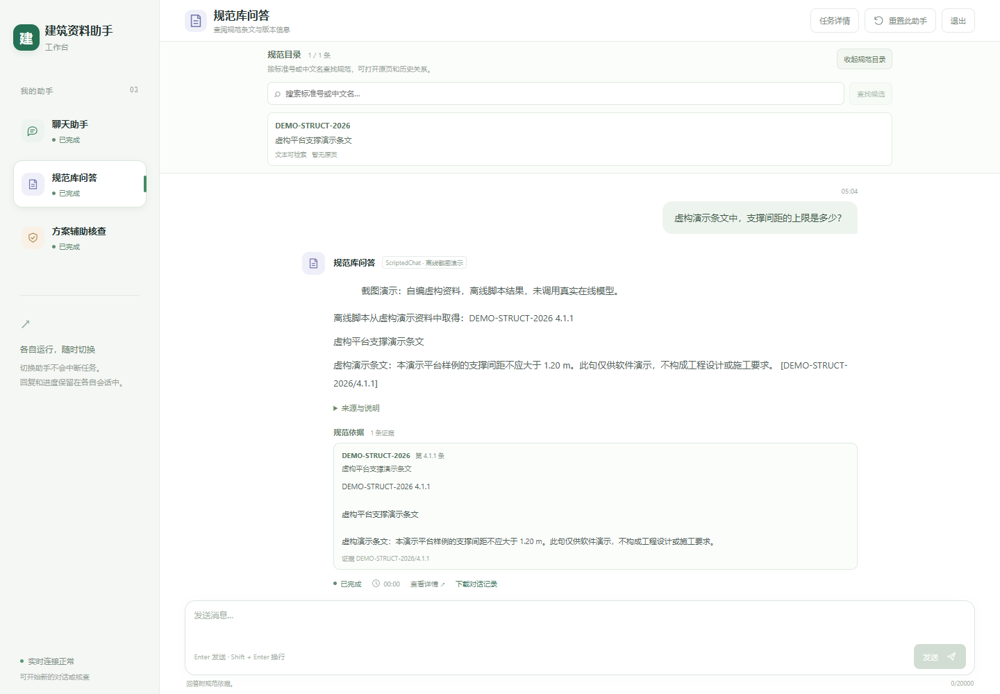
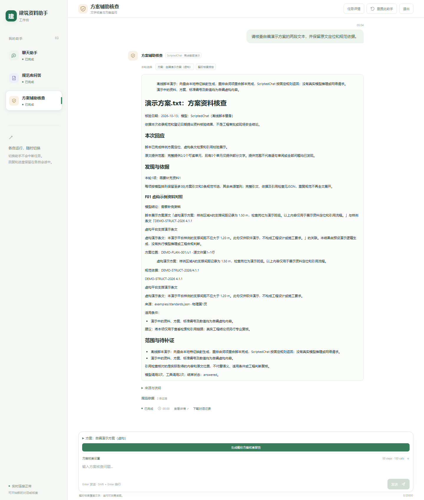

# RAG Arch Demo｜React + FastAPI 建筑资料助手

[English](README.md) | [简体中文](README_CN.md)

这是建筑资料助手的代码展示仓库。默认 Web 入口是 React 单页应用，由 FastAPI 后端提供服务。可以沿着代码查看资料上传、检索、证据引用、方案核查、任务进度与取消、来源页查看和报告下载的实现。

公开目录包含选取的应用代码和自编样例，不包含私有规范库、原件、凭据或运行数据库。因此，主 Web 工作台不是开箱即用的公开服务；使用者需要自行准备兼容的模型配置、资料库和所需来源文件。请先看[Web 启动说明](docs/web_setup.md)。

## 主 Web 工作台

React 页面调用 FastAPI 的工作区、助手任务、SSE 进度、任务取消、资料上传、来源页、历史记录和报告下载接口，后端再连接保留的检索与 Agent 实现。代码展示实际应用链路，项目私有资料不随仓库发布。

登录功能管理本地账号，但多个账号共用本地工作区和运行数据，不提供按账号隔离数据。仓库中的启动方式将服务绑定到本机地址，适合本地阅读和检查。

## 保留的独立样例入口

自编的离线 CLI 小样例仍可运行：

~~~~bash
python -m demo --output output
~~~~

结果写入 output/，包括 Markdown 报告和 JSON 结果。离线模式以确定性替身代替模型、向量和重排服务，只演示自编样例覆盖的流程，不能据此核查任意方案。

独立的无密钥 Streamlit 小样例保留在 streamlit_demo.py：

~~~~bash
python -m pip install -r requirements-demo.txt
python -m streamlit run streamlit_demo.py --server.address 127.0.0.1 --server.port 8501
~~~~

它是轻量独立样例，不是 React/FastAPI 主工作台。首次发布时的 Streamlit 历史截图见下方链接。

## 核心实现与贡献范围

我主导完成建筑资料助手的实现，并有权公开本仓库选取的代码。源码展示资料读取与来源定位、BM25 和向量检索、RRF 融合、重排、证据工具、Agent 工具循环、方案引句核验、引用校验和报告交付。课程借鉴说明与第三方组件信息保留在[来源说明](THIRD_PARTY_NOTICES.md)。

[架构说明](docs/architecture.md)将 Web 与检索链路映射到源码；[Web 启动说明](docs/web_setup.md)说明主应用所需的配置和由使用者准备的资料。

## React + FastAPI 界面截图

截图在隔离的临时环境中拍摄：将离线样例结果接入当前 React 页面。画面资料为自编虚构内容。正常使用主工作台仍需自行配置 API、资料库和来源文件；截图不代表在线模型服务或生产部署已验证。

首次发布时的 Streamlit 截图仍保留：[资料](docs/screenshots/01-library.png)、[检索与引用](docs/screenshots/02-qa.png)和[方案核查](docs/screenshots/03-review.png)。

## 现有效果与限制

历史 60 题检索回归中，同一 RRF 候选池加入重排后，Recall@8 为 0.8444→0.8722，完整证据命中为 44/60→47/60；Top-4 完整证据同时由 40/60 降至 39/60。固定 240 题 AECBench 问答中，可解码选项正确率为 146/240→184/240。

五方案整案评测采用 59 个固定开发参考项，结果是参考覆盖，不是全报告准确率；未证明 RAG 稳定提高整案技术发现。[效果说明](docs/evaluation.md)介绍评测范围、人工复核对照、不利结果和不能归因的变化。公开样例不复现这些成绩。

引用校验能检查来源与引句，不能自动证明工程适用性、结论正确或缺陷发现完整。文字提取缺口、图表和复杂计算仍需人工复核。

## 仓库导航

- frontend/：React 页面与构建配置。
- rag_arch/web/：FastAPI 应用、登录、任务、上传、来源与历史接口。
- rag_arch/：检索、证据、Agent、方案核查和报告实现。
- demo/、examples/：离线 CLI 样例与自编虚构输入。
- streamlit_demo.py：独立的小型 Streamlit 样例。
- docs/：启动、架构、效果、发布范围说明、新版 React 截图和历史 Streamlit 截图。

[首次发布验证记录](docs/validation.md)验证的是原 Streamlit 样例，不是当前 React/FastAPI 工作台。[发布说明](docs/publication.md)介绍本次公开源码的范围。

本次有限验证见[前后端迁移验证](docs/web_validation_20261013.md)。

## 许可证

本项目自有代码采用 [MIT 许可](LICENSE)。第三方依赖遵循各自许可，不保证依赖及产物满足所有商业用途；使用者应自行核对相关授权。组件与来源见[第三方说明](THIRD_PARTY_NOTICES.md)。
