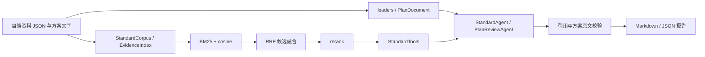

# 架构与代码阅读路线

[English](architecture_en.md) | [简体中文](architecture.md)

| 链路 | 主要源码 | 可追问的实现细节 |
|---|---|---|
| 资料读取 | `rag_arch/loaders.py`、`splitting.py`、`plan_documents.py` | TXT/MD/PDF/DOCX 文字、行号/页码、扫描页缺口、上传限制 |
| 检索 | `retrieval.py`、`evidence_index.py` | 中文单字/二元词、完整数字词元、BM25、向量归一化、RRF、候选池与 Top-k |
| 重排 | `reranking.py`、`providers.py` | 单批候选重排、响应校验、异常显式传递、服务分别配置 |
| 证据工具 | `standard_tools.py`、`standard_status.py` | 检索/按条号读取、关联表格补全、条文可读性与版本状态区别 |
| 问答 | `graph_agent.py` | LangGraph 模型/工具循环、调用预算、取得证据与最终引用的核对 |
| 方案核查 | `plan_review_agent.py`、`plan_review_context.py`、`plan_review_evidence.py` | 全文优先、容量不足时分批、方案引句定位、证据组装与来源覆盖 |
| 输出 | `plan_output.py`、`plan_review_report.py` | 自然报告与结构化报告、引用问题和工程判断分离、Markdown/JSON 导出 |
| 模型输入 | `model_input_view.py`、`standard_model_view.py` | 重复元数据共享、按需查完整状态、保留证据正文与位置 |

本版标准资料由自编 JSON 组装成 `StandardCorpus`；方案文字实际经 `load_uploaded_document` / `loaders` 读取后保留行号。原 PDF/DOCX 读取和通用切分代码保留供阅读，本次样例没有运行扫描件处理。

`demo/` 是演示入口，`rag_arch/` 是保留的业务实现。少量名字包含 benchmark/experiment 的文件因正式模块的工具函数依赖一同保留，没有携带题库、运行日志或真实评测输入。

离线模式的模型、向量和重排为确定性替身，用于观察同一业务链路如何取证与交付。它只能处理自编样例明确设计的主题，不能据此声称完成任意施工方案的模型审查。在线模式将替身换为原 `providers.py` 构造的服务客户端，调用可能产生费用。

原系统的 Web 前后端、用户上传历史、运维和完整规范库不在本版。扫描件 OCR 与复杂工程计算不在演示范围。
