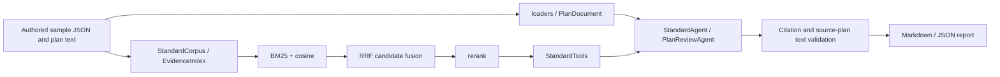

# Architecture and Code Reading Guide

[English](architecture_en.md) | [简体中文](architecture.md)

| Stage | Main source files | Implementation details to explore |
|---|---|---|
| Document loading | `rag_arch/loaders.py`, `splitting.py`, `plan_documents.py` | TXT/MD/PDF/DOCX text, line numbers/page numbers, gaps for scanned pages, upload limits |
| Retrieval | `retrieval.py`, `evidence_index.py` | Chinese single-character/bigram terms, complete numeric tokens, BM25, vector normalization, RRF, candidate pool and Top-k |
| Reranking | `reranking.py`, `providers.py` | Reranking candidates in one batch, response validation, explicit error propagation, separate service configuration |
| Evidence tools | `standard_tools.py`, `standard_status.py` | Search/read by clause number, related-table completion, distinction between clause readability and version status |
| Q&A | `graph_agent.py` | LangGraph model/tool loop, call budget, checking retrieved evidence against final citations |
| Plan review | `plan_review_agent.py`, `plan_review_context.py`, `plan_review_evidence.py` | Full-text-first review, batching when capacity is insufficient, locating plan quotations, evidence assembly and source coverage |
| Output | `plan_output.py`, `plan_review_report.py` | Narrative and structured reports, separating citation issues from engineering judgments, Markdown/JSON export |
| Model input | `model_input_view.py`, `standard_model_view.py` | Sharing repeated metadata, looking up full status on demand, preserving evidence text and location |

In this version, authored JSON is assembled into a `StandardCorpus`; plan text is read through `load_uploaded_document` / `loaders` and retains line numbers. The original PDF/DOCX reading and general-purpose splitting code remains available to inspect, but scanned-document processing was not run on this sample.

`demo/` is the demo entry point, and `rag_arch/` contains the retained business implementation. A small number of files whose names include benchmark/experiment were retained because formal modules depend on their utility functions; benchmark questions, run logs, and real evaluation inputs are not included.

In offline mode, the model, embedding, and reranking components are deterministic stand-ins. They let you follow how the same business flow gathers evidence and produces a deliverable. They only handle topics explicitly designed into the authored sample; this does not demonstrate model review of arbitrary construction plans. In online mode, the stand-ins are replaced by service clients constructed by the original `providers.py`; calls may incur charges.

The original system’s web front end and back end, user upload history, operations tooling, and complete standards library are outside this release. Scanned-document OCR and complex engineering calculations are outside the demo scope.